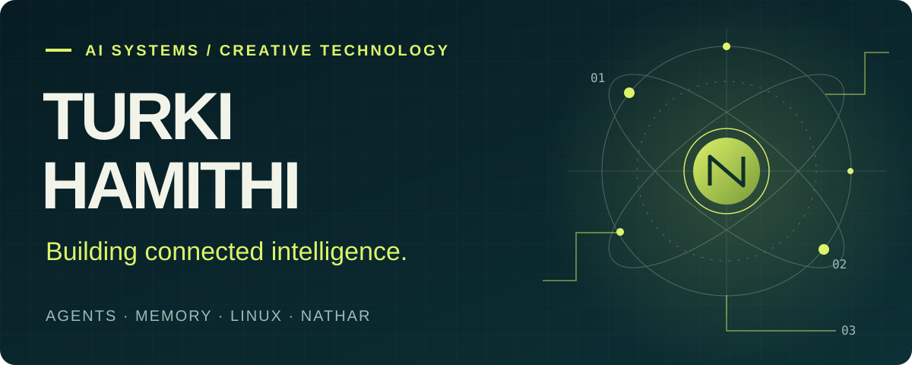
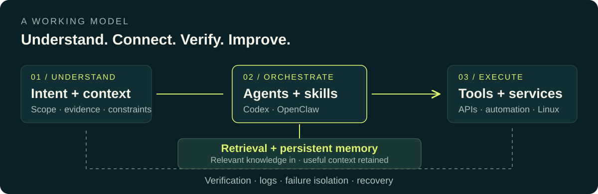

<picture>
  <source media="(max-width: 600px)" srcset="assets/hero-mobile.svg" />
  
</picture>

  <a href="https://natahr.com/"><strong>NATHAR →</strong></a>&nbsp; · &nbsp;
  <a href="#open-source">Open source</a>&nbsp; · &nbsp;
  <a href="#selected-work">Experiences</a>&nbsp; · &nbsp;
  <a href="#how-i-build">How I build</a>&nbsp; · &nbsp;
  <a href="#بالعربية">العربية</a>

### I build the experience and the system behind it.

I'm **Turki Hamithi**, building **[NATHAR | نَظَر](https://natahr.com/)**: open-source tools for AI agents and interactive web experiences. Explore the code in **Nathar Observe**, or step into the research-led experiences below.

**What you'll find here**

- **Agent tooling** · Context retrieval, explainable skill routing and structured handoffs
- **Open implementations** · Python, local-first search, optional Qdrant indexing and documented integration
- **Interactive research** · Arabic experiences with linked sources, visual models and adjustable controls

## Open source

### [Nathar Observe →](https://github.com/abuegab1-spec/nathar-observe)

**Relevant context. The right skills. A clear handoff.**

A local-first CLI and Python library for AI agents. Observe finds relevant notes,
routes a task to installed `SKILL.md` guides, and explains its choices in JSON.
It works with any agent that can run a command or read the output.

- **Try it locally** · The included synthetic example needs no API key or model download
- **Inspect the reasoning** · Source paths, matching details, excluded candidates and retrieval issues are part of the result
- **Extend when needed** · Optional semantic indexing, explicit conversation exports and wikilink navigation

Python 3.10+ · CLI + Python library · MIT · Package version 0.1.0

**[Source & quick start](https://github.com/abuegab1-spec/nathar-observe#quick-start)** ·
[Usage guide](https://github.com/abuegab1-spec/nathar-observe/blob/main/docs/usage.md) ·
[Agent integration](https://github.com/abuegab1-spec/nathar-observe/blob/main/docs/integration.md) ·
[الشرح العربي](https://github.com/abuegab1-spec/nathar-observe/blob/main/docs/README.ar.md)

<strong>What the handoff means</strong>

Lexical search is the default and works offline after installation. Semantic
search is optional and requires separate setup and indexing. Observe prepares
context and routing; the executing agent still reads the sources, applies the
guides and verifies the task result.

## Selected work

Three live NATHAR experiences, built around research, interaction and a distinct visual world. Open a project to explore its sources, interactive models and visual story.

### [01 · Samaa / السماء →](https://natahr.com/samaa/)
**Astronomy as an interactive journey.** Twelve chapters exploring the universe and the limits of knowledge, with orbit and cosmic-expansion controls, linked sources and a motion toggle.

HTML · CSS · JavaScript · Canvas starfield · Interactive models

 

### [02 · Subat / سبات →](https://natahr.com/subat/)
**Making invisible processes explorable.** A twelve-chapter journey through sleep, dreams and memory, with adjustable signal displays, sleep-stage and caffeine controls, and 33 cited sources.

HTML · CSS · JavaScript · Canvas · Interactive scientific storytelling

 

### [03 · UNSINKABLE / سفينة لا تغرق →](https://natahr.com/unsinkable/)
**History you navigate. Engineering you can question.** A twelve-chapter Titanic experience combining cinematic scrollytelling with an interactive flooding threshold, optional sound and motion controls.

HTML · CSS · JavaScript · GSAP · ScrollTrigger · Interactive simulation

 

**More from NATHAR:** [Markets](https://natahr.com/markets/) · [Outlook](https://natahr.com/outlook/) · [OFOQ model guide](https://natahr.com/Astra/)

## How I build

<picture>
  <source media="(max-width: 600px)" srcset="assets/system-map-mobile.svg" />
  
</picture>

*A conceptual model of how I approach systems.*

1. **Start with evidence.** Question assumptions, return to first principles and make the sources inspectable.
2. **Keep the pieces modular.** Separate agent orchestration, memory and supporting services so each can evolve without entangling the rest.
3. **Test before rollout.** Isolate changes, trace failures through logs and turn bugs into reproducible reports.
4. **Treat boundaries as part of the design.** Keep credentials and private infrastructure out of public artifacts. Prefer verified fixes and maintainable recovery paths over chains of workarounds.

## Explore further

- **Build with the code** · [Nathar Observe](https://github.com/abuegab1-spec/nathar-observe) includes a runnable example, an agent skill and an integration contract
- **Explore the experiences** · [NATHAR](https://natahr.com/) brings together interactive research, visual storytelling and practical tools
- **Inspect the checks** · [Observe's test workflow](https://github.com/abuegab1-spec/nathar-observe/actions/workflows/tests.yml) runs tests, package builds and the quick-start example on Linux and Windows

## بالعربية

أنا **تركي**. أبني **[نَظَر | NATHAR](https://natahr.com/)**: أدوات مفتوحة لوكلاء الذكاء الاصطناعي، وتجارب معرفية تفاعلية بالعربية.

تجمع أعمالي بين الأدوات المفتوحة والتجارب البصرية:

- **[Nathar Observe](https://github.com/abuegab1-spec/nathar-observe)**: أداة تسترجع السياق المحلي وتختار أدلة المهارات المناسبة للمهمة، وتوضح أسباب الاختيار في نتيجة JSON. يتوفر معها مثال للتجربة و[دليل عربي](https://github.com/abuegab1-spec/nathar-observe/blob/main/docs/README.ar.md)
- **[السماء](https://natahr.com/samaa/)**: رحلة في علم الفلك وحدود المعرفة، مع نماذج تفاعلية ومصادر يمكن الرجوع إليها
- **[سبات](https://natahr.com/subat/)**: استكشاف للنوم والأحلام والذاكرة
- **[سفينة لا تغرق](https://natahr.com/unsinkable/)**: تجربة تفاعلية عن تيتانيك تجمع السرد التاريخي بالنموذج الهندسي

أبدأ من فهم المشكلة والتحقق من مصادرها، وأهتم بعزل التغييرات واختبارها، وتشخيص الأعطال، وبناء حلول قابلة للصيانة. في Observe، تجهيز السياق خطوة تسبق التنفيذ؛ التحقق من المصادر والنتيجة يبقى جزءًا من عمل الوكيل.

<a href="https://natahr.com/"><strong>Explore NATHAR →</strong></a>

